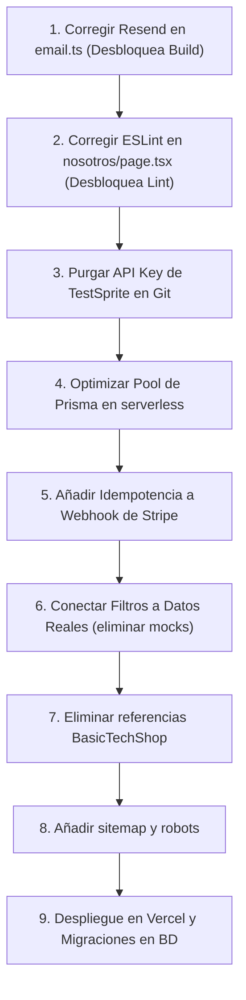

# 🛡️ Informe de Auditoría Senior de Pre-Despliegue

**Proyecto:** Cyc Regalos — Comercio Online  
**Objetivo de Despliegue:** Vercel (Next.js 16.1.1 App Router + PostgreSQL Neon/Supabase)  
**Mercado y Moneda:** Chile / CLP ($)  
**Pasarelas:** Stripe & Webpay Plus (Transbank)  
**Auditor:** Senior Full-Stack & Security Engineer  
**Estado:** Auditoría completa — Código intacto a la espera de autorización

---

## 📊 Resumen Ejecutivo del Diagnóstico

| Nivel de Severidad | Cantidad de Hallazgos | Estado |
|---|:---:|---|
| 🔴 **CRÍTICO** (Bloquea compilación, seguridad comprometida o fallo de pago) | **5** | Requiere solución inmediata |
| 🟠 **ALTO** (Fallo en build de Vercel, branding roto o bypass de UI) | **5** | Bloquea lanzamiento comercial |
| 🟡 **MEDIO** (Rendimiento, SEO, logs excesivos, configs) | **5** | Resolver antes de tráfico masivo |
| 🔵 **BAJO** (Mejores prácticas de testing y tipado) | **3** | Mantenimiento posterior |

---

## 🔴 Hallazgos de Severidad CRÍTICA

### 1. Showstopper de Compilación: `new Resend(undefined)` aborta `next build`
- **Archivo y Línea:** [`src/lib/email.ts:3`](file:///c:/Users/Snooze/Documents/codigo/proyectos%20personales/comercio-online-regalos/src/lib/email.ts#L3)
- **Problema:** Se instancia `const resend = new Resend(process.env.RESEND_API_KEY)`. Si `RESEND_API_KEY` no está inyectada en el entorno de compilación de Vercel (o en desarrollo local), el constructor de la SDK de Resend lanza `Error: Missing API key` durante la recolección de rutas estáticas (`/api/orders`), provocando que `next build` aborte con error código 1.
- **Corrección Concreta:**
  ```typescript
  // src/lib/email.ts
  const resend = process.env.RESEND_API_KEY
    ? new Resend(process.env.RESEND_API_KEY)
    : null
  ```
  Y en `sendOrderConfirmationEmail`, verificar `if (!resend) { ... return { success: false } }`.

---

### 2. Secreto de TestSprite commiteado en texto plano en Git
- **Archivo y Línea:** [`.claude/settings.local.json:6`](file:///c:/Users/Snooze/Documents/codigo/proyectos%20personales/comercio-online-regalos/.claude/settings.local.json#L6)
- **Problema:** Contiene una API key real de TestSprite (`API_KEY=sk-user-[REVOKED_TESTSPRITE_KEY]`) en texto claro commiteada en el commit `e918cfc7`. El archivo `.claude` no está en `.gitignore`.
- **Pasos Exactos de Remediación:**
  1. Revocar de inmediato la API key en el panel de [TestSprite](https://www.testsprite.com).
  2. Agregar `.claude` y `.claude/` al archivo [`.gitignore`](file:///c:/Users/Snooze/Documents/codigo/proyectos%20personales/comercio-online-regalos/.gitignore).
  3. Eliminar el archivo del árbol actual de Git: `git rm -r --cached .claude`.
  4. Purgar el archivo del historial completo de Git usando `git-filter-repo` o BFG Repo-Cleaner:
     ```bash
     git filter-repo --path .claude/settings.local.json --invert-paths --force
     git push origin master --force
     ```

---

### 3. Fuga y Agotamiento de Conexiones Serverless en `PrismaClient` / `pg.Pool`
- **Archivo y Línea:** [`src/lib/prisma.ts:11-19`](file:///c:/Users/Snooze/Documents/codigo/proyectos%20personales/comercio-online-regalos/src/lib/prisma.ts#L11-L19)
- **Problema:** 
  1. `new Pool({ connectionString: process.env.DATABASE_URL })` no define `max` ni `idleTimeoutMillis`. Por defecto, `pg` asigna 10 conexiones por cada instancia serverless de Vercel. Con 5-10 peticiones concurrentes, se abren 50-100 conexiones simultáneas, agotando los límites de Neon (20 conexiones) o Supabase.
  2. La instancia de `pool` no se guarda en el objeto `globalThis` (solo `prisma`), provocando que cada hot-reload en desarrollo cree pools huérfanos sin cerrar los anteriores.
- **Corrección Concreta:**
  Configurar el pool para serverless:
  ```typescript
  // src/lib/prisma.ts
  const globalForPrisma = globalThis as unknown as {
    prisma: PrismaClient | undefined
    pool: Pool | undefined
  }

  function getPool() {
    if (!globalForPrisma.pool) {
      globalForPrisma.pool = new Pool({
        connectionString: process.env.DATABASE_URL,
        max: process.env.NODE_ENV === "production" ? 1 : 5, // 1 conexión por función serverless
        idleTimeoutMillis: 30000,
        connectionTimeoutMillis: 5000,
      })
    }
    return globalForPrisma.pool
  }

  function createPrismaClient() {
    const adapter = new PrismaPg(getPool())
    return new PrismaClient({ adapter })
  }

  export const prisma = globalForPrisma.prisma ?? createPrismaClient()
  if (process.env.NODE_ENV !== "production") globalForPrisma.prisma = prisma
  ```

---

### 4. Falta de Idempotencia en el Webhook de Stripe (Riesgo de Doble Cargo y Descuento de Stock)
- **Archivo y Línea:** [`src/app/api/webhook/stripe/route.ts:94-138`](file:///c:/Users/Snooze/Documents/codigo/proyectos%20personales/comercio-online-regalos/src/app/api/webhook/stripe/route.ts#L94-L138)
- **Problema:** En el evento `checkout.session.completed`, se crea la orden directamente con `prisma.order.create` sin verificar si ya existe una orden registrada con `stripeSessionId: session.id`. Si Stripe retransmite el webhook debido a un retraso de red o timeout temporal (comportamiento estándar de Stripe), se creará un pedido duplicado en la base de datos y se descontará el inventario dos veces.
- **Corrección Concreta:**
  ```typescript
  // Verificar idempotencia antes de crear la orden
  const existingOrder = await prisma.order.findFirst({
    where: { stripeSessionId: session.id },
  })
  if (existingOrder) {
    return NextResponse.json({ received: true, status: "already_processed" })
  }
  ```

---

### 5. Componentes Principales Consumiendo Datos Mock Obsoletos de Computación
- **Archivos Afectados:**
  - [`src/components/products/CategoryFilter.tsx:7`](file:///c:/Users/Snooze/Documents/codigo/proyectos%20personales/comercio-online-regalos/src/components/products/CategoryFilter.tsx#L7): Importa `categories` fijas de `mock-products.ts` (Computadoras, Monitores, Teclados, Mouse...) en lugar de las categorías de Cyc Regalos (Boxes, Papelería, Joyería...).
  - [`src/components/products/BrandFilter.tsx:8`](file:///c:/Users/Snooze/Documents/codigo/proyectos%20personales/comercio-online-regalos/src/components/products/BrandFilter.tsx#L8): Importa marcas fijas de `mock-products.ts` (ASUS, MSI, Corsair...).
  - [`src/components/home/BrandSection.tsx:1`](file:///c:/Users/Snooze/Documents/codigo/proyectos%20personales/comercio-online-regalos/src/components/home/BrandSection.tsx#L1): Renderiza marcas de computación en el home.
  - [`src/app/(admin-panel)/admin/payments/page.tsx:31`](file:///c:/Users/Snooze/Documents/codigo/proyectos%20personales/comercio-online-regalos/src/app/(admin-panel)/admin/payments/page.tsx#L31): Importa transacciones falsas en USD.
- **Problema:** Al hacer clic en los filtros de la tienda, el usuario filtra por categorías que no existen en la base de datos, resultando en catálogos vacíos.
- **Corrección Concreta:** Conectar `CategoryFilter` y `BrandFilter` a `useProductsStore` (que ya tiene los métodos `fetchCategories` y `fetchBrands`) o pasar las categorías y marcas reales como props desde la página del catálogo.

---

## 🟠 Hallazgos de Severidad ALTA

### 6. Errores de ESLint Bloquean el Build de Vercel
- **Archivo y Línea:** [`src/app/nosotros/page.tsx:25-26`](file:///c:/Users/Snooze/Documents/codigo/proyectos%20personales/comercio-online-regalos/src/app/nosotros/page.tsx#L25-L26)
- **Problema:** Comillas dobles sin escapar `"` violan la regla `react/no-unescaped-entities`. En el pipeline de Vercel, `next build` ejecuta `eslint` por defecto; al existir errores de severidad `error`, la compilación se interrumpe inmediatamente.
- **Corrección:** Reemplazar `"` por `&quot;` o comillas tipográficas `« »` en el JSX.

---

### 7. Rango de Precios en Zustand incompatible con Moneda CLP
- **Archivo y Línea:** [`src/stores/products-store.ts:25`](file:///c:/Users/Snooze/Documents/codigo/proyectos%20personales/comercio-online-regalos/src/stores/products-store.ts#L25)
- **Problema:** `priceRange: [0, 10000]`. En CLP, los productos de Cyc Regalos van desde $12.000 hasta $55.000. Si un usuario interactúa con el filtro de precio, la consulta `/api/products?maxPrice=10000` oculta absolutamente todos los productos del catálogo.
- **Corrección:** Cambiar el rango inicial en el store a `[0, 100000]`.

---

### 8. Órdenes Huérfanas en Webpay por Cancelación del Usuario
- **Archivo y Línea:** [`src/app/api/webpay/commit/route.ts:48-50`](file:///c:/Users/Snooze/Documents/codigo/proyectos%20personales/comercio-online-regalos/src/app/api/webpay/commit/route.ts#L48-L50)
- **Problema:** Cuando el cliente cancela la operación en la pasarela de Transbank, Transbank redirige con `TBK_TOKEN`. El endpoint detecta la cancelación y redirige a `/checkout/cancel`, pero no actualiza la orden previamente creada en `webpay/create`, dejándola en estado `PENDING` permanentemente en la base de datos.
- **Corrección:** En caso de `cancelled`, buscar la orden mediante el token/buy_order y actualizar su estado a `CANCELLED`.

---

### 9. Remanentes de Marca "BasicTechShop" en Vistas de Usuario y Admin
- **Archivos y Líneas:**
  - [`src/app/(auth)/login/page.tsx:28`](file:///c:/Users/Snooze/Documents/codigo/proyectos%20personales/comercio-online-regalos/src/app/(auth)/login/page.tsx#L28): Texto `BasicTech` en login.
  - [`src/app/(auth)/register/page.tsx:28`](file:///c:/Users/Snooze/Documents/codigo/proyectos%20personales/comercio-online-regalos/src/app/(auth)/register/page.tsx#L28): Texto `BasicTech` en registro.
  - [`src/app/(admin-panel)/admin/page.tsx:24`](file:///c:/Users/Snooze/Documents/codigo/proyectos%20personales/comercio-online-regalos/src/app/(admin-panel)/admin/page.tsx#L24): "Bienvenido al panel de administración de BasicTechShop".
  - [`src/app/(admin-panel)/admin/settings/page.tsx:64`](file:///c:/Users/Snooze/Documents/codigo/proyectos%20personales/comercio-online-regalos/src/app/(admin-panel)/admin/settings/page.tsx#L64): `storeName` por defecto "BasicTechShop" y correo `info@basictechshop.com`.
  - [`src/stores/cart-store.ts:80`](file:///c:/Users/Snooze/Documents/codigo/proyectos%20personales/comercio-online-regalos/src/stores/cart-store.ts#L80): Clave persistente en `localStorage`: `"basictech-cart"`.
  - [`package.json:2`](file:///c:/Users/Snooze/Documents/codigo/proyectos%20personales/comercio-online-regalos/package.json#L2): `"name": "ecommerce-basictech"`.
- **Problema:** Inconsistencia grave de identidad de marca para el cliente final y auditores de pasarelas de pago.
- **Corrección:** Reemplazar todas las menciones por `Cyc Regalos` y la clave del storage por `"cycregalos-cart"`.

---

### 10. Ausencia de Cabecera Content-Security-Policy (CSP)
- **Archivo y Línea:** [`next.config.ts:3-28`](file:///c:/Users/Snooze/Documents/codigo/proyectos%20personales/comercio-online-regalos/next.config.ts#L3-L28)
- **Problema:** Se configuraron cabeceras HSTS, X-Frame-Options y nosniff, pero no se definió CSP. Para un e-commerce que procesa pagos con Stripe y Transbank, la falta de CSP expone a ataques XSS dirigidos a captura de formularios o inyección de scripts externos.
- **Corrección:** Definir CSP permitiendo dominios requeridos (`https://js.stripe.com`, `https://webpay3g.transbank.cl`, `https://res.cloudinary.com`).

---

## 🟡 Hallazgos de Severidad MEDIA

### 11. 88 declaraciones de `console.*` en `src/`
- **Archivos:** Distribuido en 37 archivos en `src/` (incluidos `lib/email.ts`, `lib/audit.ts`, webhook de Stripe y rutas de API).
- **Problema:** En producción en Vercel, `console.error` y `console.log` sin controlar generan sobrecostos en Vercel Log Drains y pueden filtrar información de depuración de solicitudes.
- **Corrección:** Crear un logger utilitario (`src/lib/logger.ts`) que solo imprima en `process.env.NODE_ENV !== "production"` o acondicionar las llamadas.

---

### 12. Variables usadas en código ausentes en `.env.example`
- **Archivo y Línea:** [`.env.example`](file:///c:/Users/Snooze/Documents/codigo/proyectos%20personales/comercio-online-regalos/.env.example)
- **Problema:**
  - `WEBPAY_API_BASE_URL` se utiliza en [`src/lib/webpay.ts:41`](file:///c:/Users/Snooze/Documents/codigo/proyectos%20personales/comercio-online-regalos/src/lib/webpay.ts#L41) para alternar entre el ambiente de integración (`webpay3gint.transbank.cl`) y producción (`webpay3g.transbank.cl`), pero no está listada en `.env.example`.
  - `FORCE_SEED` se requiere en [`prisma/seed.ts:15`](file:///c:/Users/Snooze/Documents/codigo/proyectos%20personales/comercio-online-regalos/prisma/seed.ts#L15) pero no está documentada.
- **Corrección:** Añadir ambas variables con su documentación en `.env.example`.

---

### 13. Falta de `robots.txt` y `sitemap.xml` para SEO
- **Problema:** El proyecto carece de `sitemap.ts` y `robots.ts` en `src/app/`. Los motores de búsqueda no podrán indexar eficazmente las fichas de productos de regalos ni las categorías en Chile.
- **Corrección:** Crear `src/app/sitemap.ts` (dinámico leyendo slugs de productos y categorías de Prisma) y `src/app/robots.ts`.

---

### 14. Advertencia de Deprecación de Convención en Next.js 16 (`middleware` vs `proxy`)
- **Archivo:** [`src/middleware.ts`](file:///c:/Users/Snooze/Documents/codigo/proyectos%20personales/comercio-online-regalos/src/middleware.ts)
- **Problema:** Next.js 16 emite: `The "middleware" file convention is deprecated. Please use "proxy" instead`.
- **Corrección:** Documentar la compatibilidad y evaluar migración a `proxy.ts` cuando el soporte de NextAuth v5 lo estandarice completamente.

---

### 15. Vulnerabilidades de Dependencias en `npm audit`
- **Problema:** Existen 32 vulnerabilidades en librerías anidadas (principalmente `@auth/core` versión beta en `next-auth@5.0.0-beta.30` y utilidades de parsing).
- **Corrección:** Ejecutar actualización controlada de paquetes menores y fijar versiones seguras en `package.json`.

---

## 🔵 Hallazgos de Severidad BAJA

### 16. Suite de Tests E2E Desactualizada
- **Directorio:** `testsprite_tests/`
- **Problema:** Los 17 archivos de prueba Playwright fueron generados para el prototipo anterior ("Laptop Lenovo", usuario `fazt@faztweb.com`). Fallarán al ejecutarse contra el catálogo actual de Cyc Regalos.
- **Corrección:** Actualizar las aserciones con los productos y usuarios del nuevo seed de Cyc Regalos.

---

### 17. Opciones de TypeScript no optimizadas para código muerto
- **Archivo:** [`tsconfig.json`](file:///c:/Users/Snooze/Documents/codigo/proyectos%20personales/comercio-online-regalos/tsconfig.json)
- **Problema:** No tiene `"noUnusedLocals": true` ni `"noUnusedParameters": true`, permitiendo variables e imports innecesarios que inflan el bundle.
- **Corrección:** Añadir dichas opciones una vez saneados los warnings de ESLint.

---

### 18. Uso de tags `` estándar en lugar de `next/image`
- **Archivos:** [`src/components/layout/Footer.tsx:42`](file:///c:/Users/Snooze/Documents/codigo/proyectos%20personales/comercio-online-regalos/src/components/layout/Footer.tsx#L42) y [`src/components/layout/Header.tsx:38`](file:///c:/Users/Snooze/Documents/codigo/proyectos%20personales/comercio-online-regalos/src/components/layout/Header.tsx#L38).
- **Problema:** Alerta de rendimiento `@next/next/no-img-element`.
- **Corrección:** Reemplazar por componentes `<Image />` de Next.js.

---

## 📋 CHECKLIST DE SALIDA A PRODUCCIÓN (Ordenada por Dependencias)



### Fase A: Desbloqueo Inmediato de Compilación y Seguridad (P0 - Bloqueantes)
- [ ] **1.** Proteger instanciación de Resend en [`src/lib/email.ts`](file:///c:/Users/Snooze/Documents/codigo/proyectos%20personales/comercio-online-regalos/src/lib/email.ts) (permite que `npm run build` pase sin requerir obligatoriamente la key en build-time).
- [ ] **2.** Corregir errores de comillas sin escapar en [`src/app/nosotros/page.tsx`](file:///c:/Users/Snooze/Documents/codigo/proyectos%20personales/comercio-online-regalos/src/app/nosotros/page.tsx) y eliminar imports no usados para que `npm run lint` salga en 0 errores.
- [ ] **3.** Revocar key de TestSprite en su panel web, agregar `.claude` a `.gitignore` y purgar `.claude/settings.local.json` de Git.
- [ ] **4.** Ajustar [`src/lib/prisma.ts`](file:///c:/Users/Snooze/Documents/codigo/proyectos%20personales/comercio-online-regalos/src/lib/prisma.ts) con límites de conexión para PostgreSQL en entornos serverless (`max: 1` por función).
- [ ] **5.** Añadir verificación de orden existente por `stripeSessionId` en [`src/app/api/webhook/stripe/route.ts`](file:///c:/Users/Snooze/Documents/codigo/proyectos%20personales/comercio-online-regalos/src/app/api/webhook/stripe/route.ts) para evitar pedidos duplicados por reintentos de Stripe.

### Fase B: Integridad de Negocio y Experiencia de Usuario (P1 - Críticos para el Comercio)
- [ ] **6.** Desvincular `CategoryFilter.tsx`, `BrandFilter.tsx` y `BrandSection.tsx` de `mock-products.ts` y conectarlos a las categorías y marcas reales de Cyc Regalos.
- [ ] **7.** Ajustar `priceRange` en [`src/stores/products-store.ts`](file:///c:/Users/Snooze/Documents/codigo/proyectos%20personales/comercio-online-regalos/src/stores/products-store.ts) a `[0, 100000]` CLP.
- [ ] **8.** Manejar cancelación de Webpay en [`src/app/api/webpay/commit/route.ts`](file:///c:/Users/Snooze/Documents/codigo/proyectos%20personales/comercio-online-regalos/src/app/api/webpay/commit/route.ts) marcando la orden como `CANCELLED`.
- [ ] **9.** Reemplazar todas las menciones residuales de "BasicTechShop" por "Cyc Regalos" (login, registro, admin, cart-store, package.json).

### Fase C: Infraestructura, Variables y SEO (P2 - Preparación Final)
- [ ] **10.** Agregar `WEBPAY_API_BASE_URL` y `FORCE_SEED` a [`.env.example`](file:///c:/Users/Snooze/Documents/codigo/proyectos%20personales/comercio-online-regalos/.env.example).
- [ ] **11.** Implementar `src/app/sitemap.ts` y `src/app/robots.ts`.
- [ ] **12.** Reemplazar tags `` por `next/image` en Header y Footer.
- [ ] **13.** Configurar política CSP en [`next.config.ts`](file:///c:/Users/Snooze/Documents/codigo/proyectos%20personales/comercio-online-regalos/next.config.ts).
- [ ] **14.** Limpiar/condicionar los 88 `console.*` con un logger de entorno.

### Fase D: Despliegue en Producción
- [ ] **15.** Crear base de datos PostgreSQL en Neon/Supabase/Railway.
- [ ] **16.** Ejecutar `npx prisma migrate deploy` en la base de datos de producción.
- [ ] **17.** (Opcional) Ejecutar `FORCE_SEED=I_KNOW_THIS_WILL_DELETE_ALL_DATA npm run db:seed`.
- [ ] **18.** Conectar repositorio a Vercel e ingresar variables de producción de `.env.example`.
- [ ] **19.** Configurar endpoint del webhook en Stripe Dashboard (`/api/webhook/stripe`) con evento `checkout.session.completed`.
- [ ] **20.** Configurar credenciales de producción de Transbank y verificar retorno a `/api/webpay/commit`.
